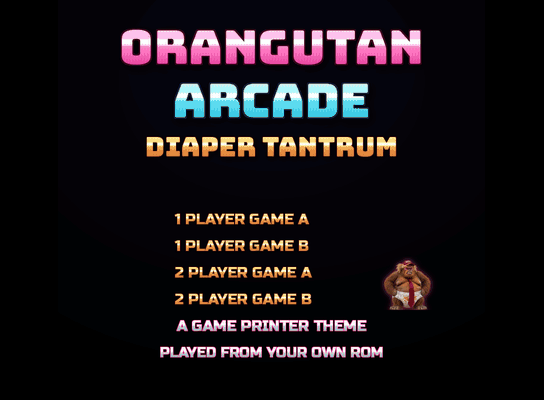

# Orangutan Arcade: Diaper Tantrum

A gross-out alternate cut of [Orangutan Arcade](https://github.com/ddmoney420/orangutan-arcade-theme), a photoreal
look and sound for Donkey Kong (NES), played from a ROM you own on a Game Printer page. Pick it under Settings, Theme.

The game is unchanged. Every body keeps its place and hit box; only the pictures and sounds change.

- **The boss** has eaten far too many cheese puffs: he wears a sagging, overstuffed adult diaper smeared with
  orange-brown stains, and he is even more furious: bared teeth, bloodshot eyes, a flushed red face. When he
  carries Señorita off, goop streams from his diaper all the way down the ladder.
- **The barrels** are full of what you'd fear. At 25m a tipped barrel pours soiled diapers out at the foot of
  the barrel stack, and by the burn barrel lies the smashed-barrel debris (staves, bent hoops, char, ash,
  embers, spilled diapers) of the ones that missed. Stink and flies rise from both piles. A barrel that lands
  in the burn barrel goes up in a flaming splat; one smashed on 25m bursts into splinters, flying diapers and
  green gas. On 50m the conveyors carry rolled-up diapers.
- **The hero** is an older man in a black polo and white cargo shorts, with a star jump on about every other
  jump, and a toilet plunger instead of the hammer.
- **Señorita** pinches her nose and fans the stink.
- At 50m the fire hangs from the girder above the cheese-puff hopper, roasting the puffs; the hopper's top
  still hurts, as in the game.
- **The sound is farts.** Every effect is one (the boss's fist thump is The Big One; the plunger lands with a
  splat; footsteps squelch; jumps go pfweeet; a barrel jumped toots; a death is a sad trombone, in Retro mode)
  and the music is played by them: pitched farts with a guttural growl carry the tunes, the drums are farts,
  and stomach grumbles fill the gaps. Each effect has two or three farts and plays them in turn (the thump
  three, the others two): a Game Printer page from 2026-11-15 on plays them all; an older page plays the
  first one every time.
- The stages and the lettering are the same as in Orangutan Arcade.

Satire.

## No ROM data

None of these files holds bytes from a Donkey Kong ROM, no picture is traced from the original's art, and no
sound or tune comes from the game. The
stages are built in the player's browser from pieces over the level picture read from the player's own ROM.
`gp template served` checked every file against Donkey Kong: Original Edition and Donkey Kong (JU): it holds
no game data.

## How the art was made

Generated with Google Gemini image models (`gemini-3-pro-image`, `gemini-nano-banana-2.1`) from our own prompts
and the main theme's own art, then cut out, fitted and animated by script. Each picture was redrawn on pure black
and on pure white, and the difference between the two gives every pixel's transparency, so there is no green
screen and no green fringe. Lettering: Russo One and Bungee (SIL Open Font License 1.1). The music and sounds are original, synthesized from scratch in code (numpy; no samples,
no recordings), with the code and the tunes written by Claude (Anthropic) at the author's direction. `promo.gif`
is a short scene made from the theme's own art (no gameplay capture).

## License

The pictures, sounds and rules are licensed under [Creative Commons Attribution 4.0 International](https://creativecommons.org/licenses/by/4.0/)
(CC BY 4.0); the full text is in `LICENSE`. Credit:

> Orangutan Arcade art by ddmoney420 (https://github.com/ddmoney420/orangutan-arcade-diaper), licensed under CC BY 4.0.

The rules' structure and the stages' colour tests follow Turnips art by lex00 (https://github.com/lex00/turnips),
licensed under CC BY 4.0; no Turnips pictures are used. Donkey Kong, its name and its ROM belong to Nintendo and
aren't licensed here.
